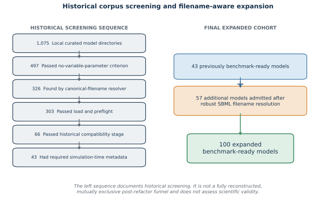
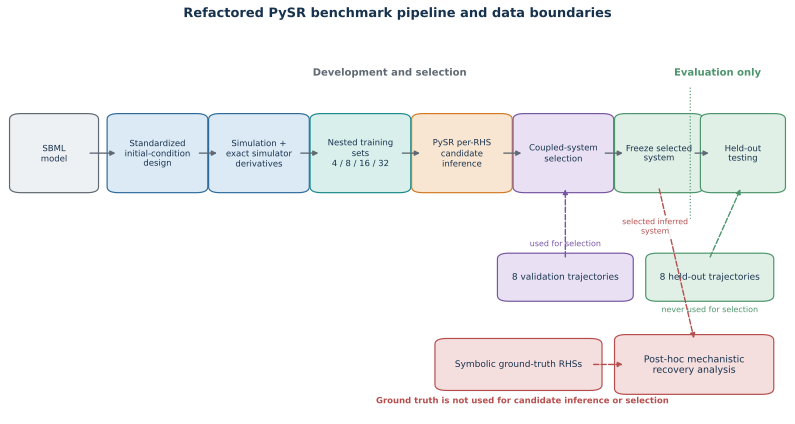
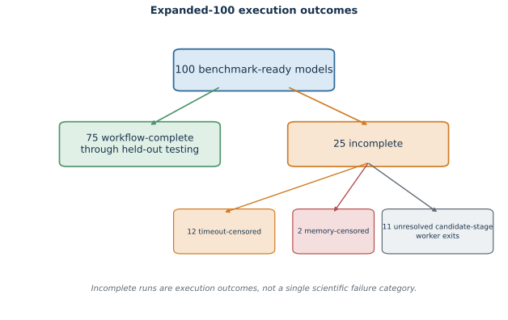
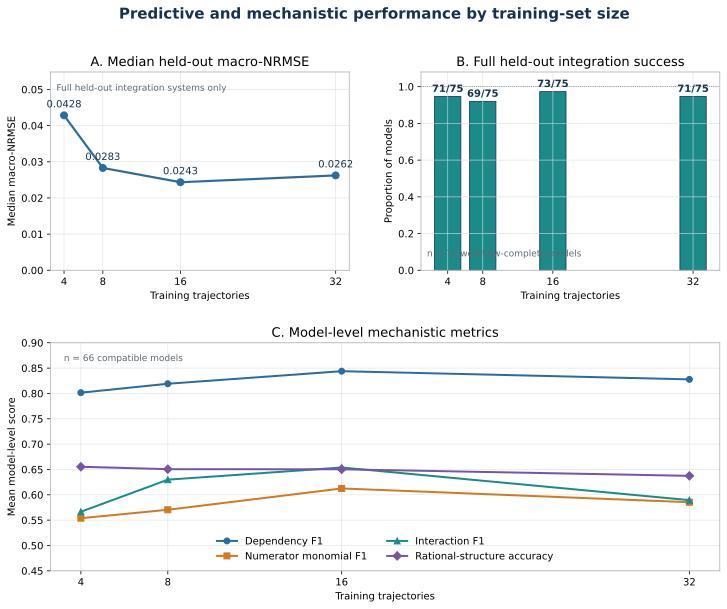
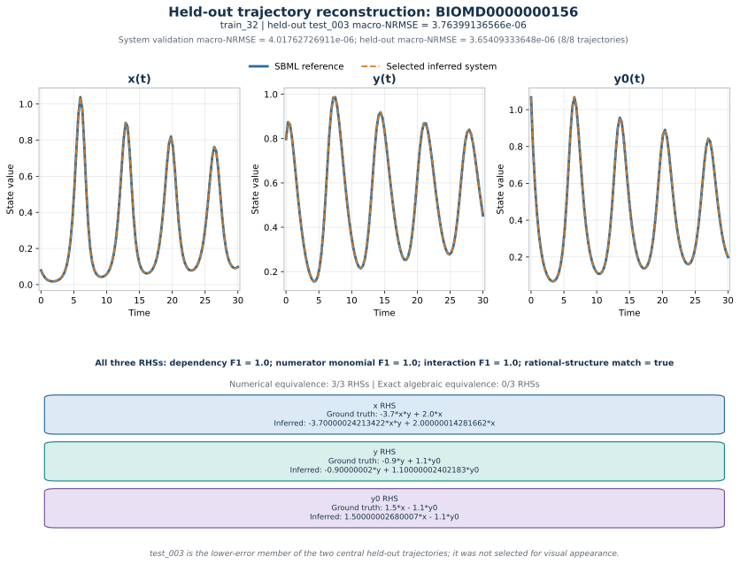
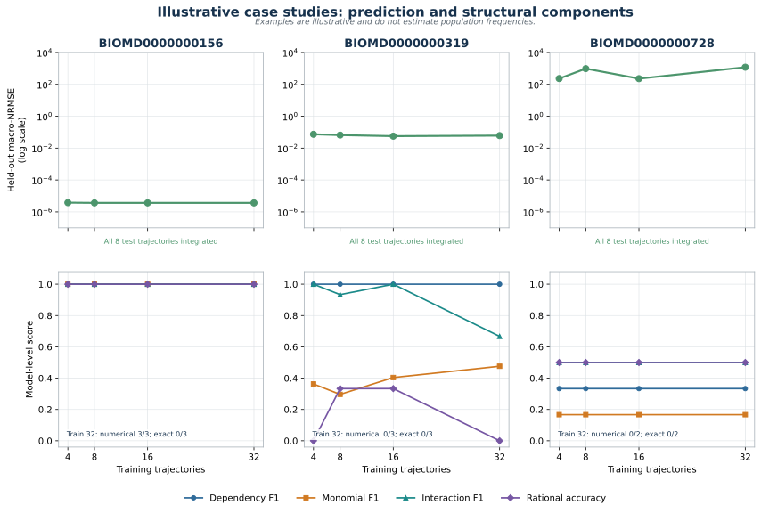
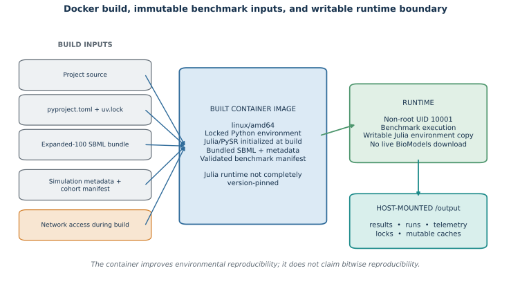

# Evaluating and Improving Symbolic Regression Methods for Biological Network Dynamics

| GSoC metadata | Details |
|---|---|
| Program | Google Summer of Code 2026 |
| Organization | National Resource for Network Biology (NRNB) |
| Contributor | Norma C Pérez Rosas |
| Mentors | Augustin Luna, Eran Agmon, Mark Kittisopikul, and Matthias König |
| Work product | PySR-BioModels benchmark |

## 1. Abstract

Mechanistic models in systems biology are frequently expressed as systems of ordinary differential equations (ODEs), but discovering those equations from observations is a difficult inverse problem. Symbolic regression offers a data-driven approach in which the mathematical expressions themselves are inferred rather than specified in advance.

This project developed **PySR-BioModels**, a reproducible benchmark for evaluating symbolic regression on curated biological ODE models from BioModels [9]. Known SBML models are used as ground-truth dynamical systems. Standardized perturbation experiments generate state trajectories and exact derivatives, PySR independently proposes candidate right-hand sides for each dynamic state, and validation trajectories are used to assemble a coupled ODE system. The selected system is then frozen and evaluated on previously unseen initial conditions.

The benchmark was designed to distinguish predictive success from mechanistic recovery. In addition to held-out trajectory error, inferred equations are evaluated for state dependencies, numerator monomials, multiplicative interactions, rational structure, finite-point numerical equivalence, and exact algebraic equivalence.

The final benchmark contains 100 benchmark-ready BioModels models. Seventy-five completed the full workflow through held-out testing, producing 300 model/training-size conditions across training sets of 4, 8, 16, and 32 trajectories. Under the fixed experimental configuration, 16 training trajectories produced the lowest median held-out macro-NRMSE (0.0243) and the highest number of complete held-out successes (73/75). Mechanistic evaluation on 66 feature-space-compatible models showed substantially stronger recovery of state dependencies than exact equations: mean dependency F1 reached 0.844 at 16 trajectories, whereas only 2 of 991 evaluable right-hand sides were exact algebraic matches, both corresponding to trivial zero equations.

These results demonstrate an important distinction for biological equation discovery: an inferred ODE system can reproduce unseen dynamics and recover meaningful structural components without being algebraically identical to the generating equations. The project also provides an auditable execution pipeline, explicit training/validation/test boundaries, mechanistic evaluation tools, provenance records, and a containerized environment for future symbolic-regression studies.

## 2. Motivation and biological context

Mathematical models are widely used to describe how interacting biological components change over time. Examples include signaling networks, metabolic pathways, gene-regulatory systems, and other biochemical reaction networks. A deterministic model with $J$ dynamic states can be represented as

$$
\frac{d\mathbf{x}}{dt}
=
\mathbf{f}(\mathbf{x}, \boldsymbol{\theta}),
$$

where $\mathbf{x}$ contains the dynamic state variables, $\boldsymbol{\theta}$ contains model parameters, and $\mathbf{f}$ specifies the mechanisms governing their rates of change.

In a conventional mechanistic-modeling workflow, the mathematical form of $\mathbf{f}$ is constructed from biological knowledge and then its parameters are estimated from experimental data. Equation discovery asks a more difficult question: **can the mathematical form itself be inferred from observations?**

This distinction matters because different equations can generate similar trajectories over a limited region of state space. A model can therefore be an excellent predictor without reproducing the mechanism that generated the data. Conversely, an inferred equation may identify biologically relevant dependencies while differing in coefficients, interactions, or algebraic form.

The central scientific problem in this project is consequently not just whether symbolic regression can fit biological time-series data. It is whether an inferred system can generalize to unseen perturbations and how closely its mathematical structure resembles the known generating system.

BioModels provides a useful environment for studying this problem because it is a curated repository of published quantitative biological models [9]. Many of these models are represented using the Systems Biology Markup Language (SBML), a standardized machine-readable format for exchanging computational models of biological processes [10]. Together, BioModels and SBML provide known dynamical systems that can serve as ground truth for equation-discovery experiments. Instead of evaluating an inferred equation against an unknown experimental mechanism, the benchmark begins with an existing model, generates controlled observations from it, hides its equations from the symbolic-regression search, and then compares the inferred system with the original equations.

## 3. Symbolic regression for biological ODE discovery

### 3.1 From trajectories to equations

For an ODE system,

$$
\frac{d\mathbf{x}}{dt}
=
\mathbf{f}(\mathbf{x}),
$$

the equation-discovery problem can be expressed as learning an approximation

$$
\frac{d\mathbf{x}}{dt}
\approx
\hat{\mathbf{f}}(\mathbf{x}),
$$

where $\hat{\mathbf{f}}$ is inferred from observations rather than specified beforehand.

In this benchmark, each dynamic state is treated as a separate symbolic-regression target during candidate generation. For state $x_j$, PySR searches for expressions of the form

$$
\frac{dx_j}{dt}
\approx
\hat{f}_j(x_1,x_2,\ldots,x_J).
$$

The individual state equations cannot ultimately be judged in isolation because they interact when integrated as a coupled ODE system. The workflow therefore retains multiple candidate expressions for each right-hand side and subsequently evaluates combinations of those candidates on validation trajectories.

### 3.2 Why symbolic regression?

Conventional regression typically estimates coefficients within a predefined mathematical structure. Symbolic regression instead searches over both mathematical structure and numerical constants. Candidate expressions can therefore differ in which variables they use, how variables interact, and which algebraic operations connect them.

This property makes symbolic regression attractive for equation discovery: its output is an explicit mathematical expression rather than only a numerical predictor. That interpretability also creates a stricter evaluation problem. Two expressions can produce similar predictions without being mathematically identical.

PySR was used as the symbolic-regression engine for the final benchmark. The objective of the project is not to establish that PySR is universally optimal, but to use a controlled PySR configuration to establish a reproducible baseline for biological ODE discovery.

### 3.3 Related work

Data-driven discovery of dynamical systems has been studied using several methodological families. A prominent example is Sparse Identification of Nonlinear Dynamics (SINDy), which identifies a sparse set of active terms from a predefined library of candidate functions [1]. Symbolic regression addresses a related problem but searches more directly over mathematical expressions rather than selecting coefficients only within a fixed candidate library.

PySR is an open-source symbolic-regression system built on SymbolicRegression.jl. It combines multi-population evolutionary search, expression simplification, numerical optimization of constants, and explicit tradeoffs between prediction error and expression complexity [2]. Although many early scientific applications of PySR focused on static relationships or symbolic distillation, subsequent studies have increasingly used it as part of dynamical-system identification workflows.

Applications to biological dynamics already exist. AI-Aristotle combined physics-informed learning with symbolic regression for gray-box identification in systems biology and used PySR, alongside gplearn, to identify missing terms in pharmacokinetic and ultradian glucose-insulin ODE models [3]. de Rooij and colleagues subsequently used PySR to obtain an interpretable symbolic expression from the learned component of a conditional universal differential-equation model of C-peptide production [4]. These studies demonstrate that PySR can participate in biological equation-discovery workflows.

Related work has also examined the recovery of governing equations in more general dynamical systems. Grigorian and colleagues used hybrid neural ODE models followed by PySR to recover governing equations for unobserved states, including experiments with Lotka-Volterra and Lorenz systems, and evaluated the discovered equations through numerical reintegration and extrapolation [5]. Other recent studies have systematically examined how trajectory transformations, symbolic-regression methods, and hybrid sparse/symbolic approaches affect recovery of ODE systems [6,7].

A particularly relevant recent application is the work of de Pomereu and Fröhlich on intracellular signaling. Their 2026 preprint applies symbolic regression with PySR to discover coarse-grained kinetic laws for ERK phosphorylation dynamics across experimentally measured perturbation contexts, together with synthetic experiments in enzymatic kinetics [8]. This provides a direct example of PySR applied to molecular signaling dynamics, although the study remains a preprint and should therefore be distinguished from peer-reviewed applications such as AI-Aristotle.

These studies also motivate an important methodological distinction for the present benchmark. Low error when fitting a vector field does not necessarily imply that the resulting coupled ODE system will reproduce trajectories after numerical integration. Conversely, good trajectory prediction does not establish that the generating equation has been recovered. Evaluating equation discovery therefore benefits from separating local derivative agreement, trajectory-level generalization, structural similarity, and exact symbolic equivalence.

The goal of PySR-BioModels is not to claim the first use of PySR for biological ODEs. Instead, this project complements prior equation-discovery studies by evaluating a fixed PySR workflow across a heterogeneous corpus of curated SBML models with known generating equations. The benchmark uses explicit training, validation, and held-out perturbations and separately evaluates predictive generalization, structural recovery, numerical equivalence, and exact algebraic recovery.
### 3.4 Prediction is not equation recovery

The benchmark deliberately separates several increasingly different questions.

First, **does the workflow complete?** A computational run must finish before its scientific result can be evaluated.

Second, **does the inferred system integrate successfully?** Numerical integration is necessary for trajectory prediction, but successful integration alone says nothing about accuracy.

Third, **does the inferred system predict unseen trajectories?** This is measured on held-out initial conditions that are not used during fitting or system selection.

Fourth, **does the inferred equation recover important structural components of the generating equation?** The benchmark evaluates state dependencies, monomial structure, multiplicative interactions, and rational structure.

Finally, **is the inferred expression actually the same mathematical function as the generating expression?** Numerical and exact algebraic equivalence are evaluated separately.

These distinctions are central to interpreting the results. Workflow completion is not recovery, successful integration is not accurate prediction, and accurate prediction is not exact symbolic identification.

## 4. Research questions

The final benchmark addresses four primary questions:

1. **Can symbolic regression produce coupled ODE systems that generalize to unseen initial conditions across a heterogeneous collection of biological models?**

2. **How does the number of training trajectories affect predictive and mechanistic performance under a fixed symbolic-regression search budget?**

3. **To what extent do inferred equations recover structural components of the known generating equations, including state dependencies, monomial structure, interactions, and rational form?**

4. **How often does strong predictive or structural agreement correspond to numerical or exact algebraic recovery of the generating right-hand sides?**

A secondary engineering objective is to make these questions reproducible. The workflow therefore records model provenance, experimental designs, stage outputs, selections, held-out boundaries, resource failures, and mechanistic-evaluation artifacts rather than reporting only a final accuracy number.

## 5. Building the BioModels benchmark corpus

### Model retrieval

At the time of corpus acquisition, BioModels listed 1,096 manually curated models. The retained local corpus contains 1,075 model directories, which form the auditable starting point for the benchmark screening reported here. The disposition of the remaining 21 models could not be reconstructed from the retained acquisition records.

BioModels identifiers remained standardized `BIOMD...` identifiers. The discovery problem concerned the filenames of valid SBML documents inside local model directories, not identifier heterogeneity.

### Screening and compatibility

Preflight screening checks whether an SBML file can be resolved and loaded and whether the model fits the benchmark's executable scope. The current design requires deterministic ODE dynamics compatible with the state-only inference task, finite positive nominal values for dynamic floating species, and usable model-specific simulation metadata. Models with unsupported constructs are excluded from this benchmark configuration; exclusion is not evidence that the underlying biological model is invalid.

Compatibility also matters after execution. Three completed models contain an explicit time dependence that is absent from the inference feature space. Their 12 training-size conditions remain in the predictive results but are labeled as feature-space mismatches and excluded from primary mechanistic averages.

### Historical selection funnel

The repository retains the following historical screening stages:

| Historical stage | Models remaining |
|---|---:|
| Local curated model directories | 1,075 |
| Passed the no-variable-parameter criterion | 497 |
| Found by the earlier canonical-filename resolver | 326 |
| Passed the earlier load/preflight stage | 303 |
| Passed the earlier compatibility stage | 66 |
| Had required simulation-time metadata | 43 |

These figures document how the initial 43-model set was produced. They are not a fully reconstructed, mutually exclusive funnel for the final benchmark pipeline: the criteria and discovery logic subsequently changed, and some historical incompatibility categories overlap.

*Figure 1. Historical screening counts and the filename-resolution expansion from 43 previously benchmark-ready models plus 57 additional models to the final 100-model cohort. The historical sequence is not presented as a reconstructed final-pipeline exclusion funnel.*

### SBML filename-resolution issue

The earlier local resolver expected the canonical filename `<BIOMD_ID>_url.xml`. Many valid downloaded SBML files instead used names such as an author/year filename, `Model.xml`, or `PVR.xml`. Directories containing those files were therefore missed even though their BioModels identifiers were standardized and their SBML could be valid.

The updated resolver first prefers the canonical filename. If it is absent, it accepts a unique XML/SBML candidate; if multiple candidates remain ambiguous, it rejects the directory rather than guessing. This is a robustness fix in local benchmark discovery, not a BioModels defect.

The change made 57 additional models benchmark-ready. Inspection of the bundled 100-model corpus confirms 43 canonical filenames and 57 noncanonical filenames. Archive identifiers can be standardized while local file layouts are not.

### Expanded 100-model benchmark

The final cohort is the disjoint union of the historical 43 models and 57 models admitted after filename-aware discovery, metadata completion, and preflight validation. Stored cohort validation reports that all 100 entries pass the final readiness checks. Each bundled model is associated with SBML content and provenance metadata.

Here, *benchmark-ready* means that a model passed structural, metadata, and preflight requirements. It does not mean that its computational run later finished, predicted accurately, or matched the reference mechanism.

## 6. Experimental design

Initial-condition factors span 0.1 to 10 times each positive nominal dynamic state value. To sample this multiplicative perturbation range systematically, independent 256-point Latin-hypercube candidate pools are generated in log10 space for training, validation, and held-out testing. Specifically, the sampling range extends from $\log_{10}(0.1)=-1$ to $\log_{10}(10)=1$ in each dimension. In this representation, a value of $-1$ corresponds to a factor of $10^{-1}=0.1$, a value of $0$ corresponds to $10^0=1$ (the nominal initial condition), and a value of $1$ corresponds to $10^1=10$. For example, if a state has a nominal initial value of 5, these three points correspond to initial values of 0.5, 5, and 50, respectively. Thus, perturbations below and above the nominal value are represented symmetrically on the logarithmic scale. Latin-hypercube sampling is a stratified sampling method that distributes samples across the range of every dimension, providing broad coverage of the multidimensional initial-condition space. A maximin criterion is then used to favor candidate points that are well separated from one another, further spreading the selected initial conditions across perturbation space.

| Split | Seed | Selected trajectories | Role |
|---|---:|---:|---|
| Training | 1010 | Nested prefixes of 4, 8, 16, and 32 | Fit state-wise candidates |
| Validation | 2020 | 8 | Select one coupled system |
| Held-out test | 3030 | 8 | Evaluate the frozen system |

A random seed fixes the initial state of a pseudorandom number generator, making a stochastic procedure reproducible. Here, the seeds 1010, 2020, and 3030 were used by the benchmark's initial-condition sampling procedure to generate the training, validation, and held-out test designs, respectively; these are not three PySR seeds. Their numerical values have no special scientific meaning and simply allow the same sampling designs to be regenerated. Separately, the PySR search itself used a fixed seed of 1010, as described below, to make the symbolic-regression search reproducible.

All training conditions use the same maximum 32-trajectory ordering, so smaller sets are nested within larger ones. Validation points are selected against the training design, and held-out points against the combined training and validation designs.

Before any test simulation is materialized, the runner validates that all selected systems and checkpoints are frozen. Held-out data are not used to choose candidates, refit coefficients, tune hyperparameters, or reselect a system.

## 7. Simulation and derivative generation

The benchmark uses a project-defined simulation protocol rather than executing every experiment in each model's SED-ML material. Every trajectory starts at time zero and contains 101 requested time points over a model-specific duration. Dynamic floating species are perturbed through their initial values; parameters remain fixed at nominal values.

For each simulated point, RoadRunner [11] returns the exact state derivatives used as PySR targets. Thus the experiment evaluates symbolic regression given noiseless simulator derivatives, not derivative estimation from sampled trajectories.

Simulation durations are read from bundled, model-aware metadata and checked for a matching model identifier and filename and for a positive finite value. During corpus preparation, an automated multimodal procedure extracted candidate simulation horizons from the largest plotted time axis in curated model figures. These model-specific durations were then retained as fixed benchmark metadata and used to define the standardized simulation horizon for each model. The benchmark therefore uses a consistent project-defined simulation protocol rather than attempting to reproduce every experimental or simulation configuration associated with each original BioModels entry.

## 8. PySR equation-discovery workflow

The current pipeline is:

1. resolve and preflight the SBML model;
2. create deterministic training, validation, and test initial conditions;
3. simulate development data and extract exact derivatives;
4. compute state scales from training data only;
5. fit one PySR candidate set per state RHS using all dynamic states as features;
6. transform retained expressions back to original coordinates and units;
7. select a coupled system by validation integration;
8. freeze and checkpoint the selected system;
9. load held-out initial conditions and evaluate the frozen system; and
10. compare selected RHSs with mechanistic ground truth where feature spaces are compatible.

*Figure 2. Benchmark workflow. Validation trajectories participate in coupled-system selection; held-out trajectories are opened only after selection is frozen, and symbolic ground truth is used only for post-hoc mechanistic analysis.*

The configured PySR version is 1.5.9. Each RHS search uses 60 iterations; binary operators `+`, `-`, `*`, and `/`; no unary operators; maximum expression size 20; parsimony 0; constant optimization; seed 1010; and deterministic serial execution. Up to eight candidates are retained per RHS, ranked stably by training loss. The expanded-run manifest does not independently record the imported package version, so 1.5.9 is the pinned and resolved project configuration rather than a separately logged runtime measurement.

State scales are maximum absolute values computed only from training data. Inputs are normalized by their state scales and each derivative target by its corresponding state scale. Retained expressions are then symbolically back-transformed. The workflow does not perform post-selection coefficient refitting.

Coupled-system selection begins from the top-ranked candidate for every RHS and performs deterministic coordinate search over states. A candidate is judged by integrating the coupled system on validation trajectories. Ties use validation macro-NRMSE, total complexity, total training loss, and a canonical system identifier. This single-start procedure is reproducible for fixed inputs, but is not guaranteed to find the globally optimal RHS combination.

## 9. Evaluation framework

The final framework reports complementary dimensions. None substitutes for all the others.

### Evaluation metrics

#### Predictive dynamics

Reference and inferred systems are integrated with SciPy's `solve_ivp` using LSODA, relative tolerance `1e-7`, absolute tolerance `1e-9`, and at most 8,000 RHS evaluations per trajectory. For state $j$ in trajectory $k$, sampled at $T$ time points, the state-specific trajectory RMSE is

$$
\operatorname{RMSE}_{k,j} =
\sqrt{\frac{1}{T}\sum_{t=1}^{T}\left(\hat{x}_{k,j}(t)-x_{k,j}(t)\right)^2}.
$$

The normalization scale is computed from training data only,

$$
s_j = \max_{r\in\mathcal{D}_{\mathrm{train}}}|x_{r,j}|,
\qquad
\operatorname{NRMSE}_{k,j} = \frac{\operatorname{RMSE}_{k,j}}{s_j}.
$$

With $J$ dynamic states, the trajectory macro-NRMSE is the unweighted state mean,

$$
M_k = \frac{1}{J}\sum_{j=1}^{J}\operatorname{NRMSE}_{k,j}.
$$

For either validation or held-out testing, the system macro-NRMSE is the unweighted mean over its $K=8$ trajectories, $K^{-1}\sum_{k=1}^{K}M_k$. The aggregate is finite only when all eight trajectories integrate successfully; otherwise the implementation records failed status and an infinite system macro-NRMSE.

#### State-dependency recovery

For each RHS, the evaluator compares the set of dynamic-state symbols in the inferred expression with the ground-truth set. Given true-positive, false-positive, and false-negative counts,

$$
P=\frac{TP}{TP+FP},\qquad
R=\frac{TP}{TP+FN},\qquad
F_1=\frac{2PR}{P+R},
$$

where the implementation evaluates F1 using the equivalent count expression $2TP/(2TP+FP+FN)$. Precision is undefined (`NaN`) when no dependencies are inferred, and recall is undefined when the ground-truth set is empty. If both sets are empty, F1 is defined as 1; if only one is empty, F1 is 0. Model-level dependency F1 macro-averages RHS scores. A high score says that the same states appear; it does not establish the same powers, interactions, coefficients, or rational form.

#### Functional-form recovery

After symbolic cancellation, the evaluator separately compares:

- numerator monomial signatures represented by sets of state-exponent patterns, with constant-only terms recorded but excluded from monomial precision, recall, and F1;
- multiplicative interactions represented by pairs of distinct states that co-occur in a numerator monomial;
- rational-structure match, a Boolean comparison of whether each denominator has dynamic-state dependence;
- denominator dependencies, compared as sets of state symbols; and
- numerator and denominator polynomial degrees and errors.

The report uses model-level macro summaries so models with more state equations do not automatically receive more weight. These metrics expose specific structural similarities; they do not constitute complete equation identity.

#### Numerical equivalence

For each evaluable RHS, true and inferred expressions are evaluated at 32 deterministic positive state vectors. Each state is independently sampled as $10^u$, $u \sim U(-1,1)$, with seed 4040. The RHS is marked numerically equivalent only if all 32 evaluations are valid and each satisfies `np.isclose` with relative tolerance `1e-6` and absolute tolerance `1e-9`.

This finite sample can identify close behavior over the sampled region, but cannot prove identity throughout state space.

#### Exact algebraic equivalence

The exact evaluator canonicalizes expressions with SymPy, subtracts the inferred RHS from the ground-truth RHS, and applies rational combination, cancellation, and simplification. A match requires the resulting difference to equal zero directly or via SymPy's symbolic equality test. It applies no numerical coefficient tolerance. Expressions that are numerically close but not symbolically identical remain nonmatches.

Predictive accuracy, component-level structural recovery, finite-point numerical equivalence, and exact algebraic equivalence are therefore distinct evaluation dimensions, not levels in a recovery hierarchy.

## 10. Expanded-100 execution outcomes

Of 100 benchmark-ready models, 75 completed the workflow through held-out testing and 25 did not. The 75 completed models produce four training-size conditions each, for 300 final conditions.

| Execution outcome | Models | Evidence-supported interpretation |
|---|---:|---|
| Workflow complete through held-out testing | 75 | Included in final analysis |
| Resource-censored: timeout | 12 | Execution limit, not a recovery result |
| Resource-censored: memory limit | 2 | Execution limit, not a recovery result |
| Other incomplete candidate-stage worker exits | 11 | Retained manifest lacks enough detail for finer classification |
| Total benchmark-ready | 100 | Passed readiness checks |

The 25 incomplete models should not be grouped under a single PySR failure label. Fourteen are directly identified as resource-censored. For the other 11, the retained manifest records nonzero worker exits during the candidate stage but does not support the stronger claim that every exit had the same numerical cause.

*Figure 3. Execution outcomes for the 100 benchmark-ready models. The 25 incomplete runs comprise 12 timeout-censored runs, 2 memory-censored runs, and 11 candidate-stage worker exits whose cause cannot be classified more finely from retained evidence.*

## 11. Predictive performance

The table summarizes the 75 workflow-complete models. A held-out success means that the selected system completed all eight test trajectories. Median macro-NRMSE is calculated only among systems with finite full-test scores.

| Training trajectories | Full held-out successes | Median held-out macro-NRMSE |
|---:|---:|---:|
| 4 | 71/75 | 0.042832 |
| 8 | 69/75 | 0.028292 |
| 16 | 73/75 | 0.024344 |
| 32 | 71/75 | 0.026234 |
| **All conditions** | **284/300** | — |

The median is primary because finite errors are strongly right-skewed; a technically successful case below has macro-NRMSE above 1,000. Under the fixed configuration, the median decreases from 4 through 16 trajectories and then increases slightly at 32. The 16-trajectory condition also has the most full held-out successes. This supports only the conclusion that 16 performed best among the tested sizes for this setup, not that it is universally optimal.

*Figure 4. Predictive and mechanistic results across training-set sizes. Predictive panels use the 75 workflow-complete models; systems with full held-out integration define the NRMSE medians. Mechanistic curves are model-level means over the 66 compatible models.*

### Concrete example: predictive agreement versus exact symbolic recovery

Figure 5 shows one held-out trajectory for BIOMD0000000156 under `train_32`. The model completed all 8 held-out trajectories, with an overall held-out macro-NRMSE of `3.6540933364804454e-06`. The displayed `test_003` trajectory has macro-NRMSE `3.763991365656924e-06`. It was chosen from the official trajectory metrics as the lower-error member of the two central trajectories among eight, not by visual inspection.

*Figure 5. Observed SBML and selected inferred-system trajectories for the held-out `test_003` initial condition, together with the three canonical RHS comparisons. The near-overlapping curves measure predictive agreement for this example; they do not establish exact equation identity.*

For each of the three RHSs, dependency F1, numerator monomial F1, and interaction F1 equal 1, and rational structure matches. All 3/3 RHSs pass the finite-point numerical-equivalence diagnostic, whereas 0/3 are exact algebraic matches. The equations show the small inferred-coefficient differences responsible for that distinction. Thus the exact nonmatches are not failures of trajectory prediction, and this single illustrative case does not estimate population-level performance.

## 12. Mechanistic recovery

Mechanistic evaluation is available for 276 of the 300 completed conditions. Six models (24 conditions) could not be evaluated because ground-truth extraction failed. Of the evaluated conditions, 12 from three explicit-time models have a feature-space mismatch. The primary comparison therefore uses 66 compatible models at four training sizes, or 264 conditions.

| Training trajectories | Mean dependency F1 | Mean numerator monomial F1 | Mean interaction F1 | Rational-structure accuracy |
|---:|---:|---:|---:|---:|
| 4 | 0.8015 | 0.5538 | 0.5666 | 0.6553 |
| 8 | 0.8191 | 0.5705 | 0.6298 | 0.6506 |
| 16 | 0.8439 | 0.6125 | 0.6539 | 0.6503 |
| 32 | 0.8277 | 0.5853 | 0.5894 | 0.6374 |

These are means of model-level macro scores, not pooled equation-level means. Dependency, numerator-monomial, and interaction F1 improve in aggregate from 4 to 16 trajectories and decline at 32. Rational-structure accuracy changes little through 16 and is lowest at 32. Together with predictive performance, this is consistent with an aggregate benefit from 4 to 16 trajectories under the fixed setup, but no further aggregate improvement at 32.

The paired model-level comparison from 4 to 32 trajectories shows why a universal monotonic claim is inappropriate:

| Metric | Improved | Unchanged | Worsened |
|---|---:|---:|---:|
| Dependency F1 | 24/66 | 27/66 | 15/66 |
| Numerator monomial F1 | 33/66 | 10/66 | 23/66 |
| Interaction F1 | 23/66 | 27/66 | 16/66 |

Even where the mean at 32 exceeds the mean at 4, substantial groups of models are unchanged or worse. Training-set size interacts with finite search, candidate ranking, coupled-system selection, model structure, and the fixed search budget.

## 13. Exact versus approximate recovery

RHS-level numerical and exact results use only the 66-model compatible cohort. The denominator is 248 RHSs for three training sizes and 247 at train 8, where one RHS algebraic evaluation timed out.

| Training trajectories | Numerically equivalent RHSs | Exactly equivalent RHSs |
|---:|---:|---:|
| 4 | 33/248 | 2/248 |
| 8 | 35/247 | 0/247 |
| 16 | 35/248 | 0/248 |
| 32 | 37/248 | 0/248 |
| **Pooled** | **140/991 (14.1%)** | **2/991 (0.2%)** |

The two exact matches are both trivial zero equations in BIOMD0000000941: the ground-truth RHS is `0` and the inferred RHS is also `0`. No nonzero RHS achieved exact algebraic equivalence, and no complete coupled system was exactly equivalent to its ground-truth system.

The numerical-equivalence rate is larger, but has a different meaning. It records agreement at a fixed finite set of sampled state points within stated tolerances. It must not be described as exact symbolic recovery. Likewise, higher dependency F1 values show that PySR often identified relevant states; they do not establish equation recovery.

## 14. Case studies

These cases illustrate separations among predictive, component-level, numerical, and exact outcomes. They are explanatory examples, not estimates of how frequently each pattern occurs.

*Figure 6. Three illustrative cases across all four training sizes. Held-out macro-NRMSE uses a logarithmic scale; structural panels separate dependency, monomial, interaction, and rational-form scores. These examples do not estimate population frequencies.*

### BIOMD0000000156

This three-state model has dependency F1, numerator monomial F1, interaction F1, and rational-structure accuracy equal to 1 at every training size. Its held-out macro-NRMSE ranges from approximately $3.65\times10^{-6}$ to $3.78\times10^{-6}$. At 32 training trajectories, all three RHSs pass the numerical-equivalence diagnostic, yet none is exactly algebraically equivalent.

The case demonstrates excellent prediction and recovery of the evaluated mechanistic components without exact symbolic identity. Coefficient differences or algebraic details can prevent exact equality even when trajectories and sampled RHS values agree closely.

### BIOMD0000000319

Dependency F1 is 1 at all four training sizes, but numerator monomial F1 ranges only from approximately 0.30 to 0.48, and rational-structure accuracy is either 0 or 1/3. Held-out macro-NRMSE ranges from approximately 0.0562 to 0.0737.

This case shows that selecting the correct state variables does not determine how they combine. Dependency recovery should not be presented as functional-form or equation recovery.

### BIOMD0000000728

All held-out integrations finish, but macro-NRMSE ranges from approximately 228 to 1,190. Across training sizes, dependency F1 is 1/3, numerator monomial F1 is 1/6, interaction F1 is 1/2, rational-structure accuracy is 1/2, and neither of the two RHSs passes the numerical or exact equivalence checks.

This case makes the integration distinction explicit: a numerically integrable selected system can still be a very poor predictor and a poor mechanistic match.

## 15. Discussion

First, corpus engineering is part of the scientific method. A resolver that assumes one canonical filename can impose an unintended selection effect even when identifiers are standardized. Discovery should prefer canonical files, handle unique alternatives, and reject ambiguity explicitly.

Second, benchmark stages need distinct names and denominators. Readiness, completion, integration, prediction, component similarity, and algebraic identity answer different questions. Keeping them separate prevents a resource limit or an integrable but inaccurate system from being misreported as a scientific result.

Third, leakage prevention should be architectural rather than conventional. Materializing held-out data only after frozen selections makes the intended boundary testable and auditable.

Fourth, model-level summaries matter in heterogeneous biological corpora. Equation-pooled averages give models with more states more influence. Both the unit of analysis and reasons for missing results should be explicit.

Finally, more training trajectories are not automatically better under a fixed search budget. The aggregate peak at 16 and mixed paired 4-to-32 outcomes motivate sensitivity experiments rather than a universal sample-size recommendation.

## 16. Software engineering and reproducibility

The workflow treats each scientific stage as a traceable artifact-producing step. Run manifests record the model cohort, frozen settings, SBML content hashes, simulation metadata, stage status, and selected-system identities. Checkpoints and artifact hashes are checked before resumption, reducing the risk of silently combining outputs generated under different settings.

Batch execution uses per-model/variant locks to avoid duplicate concurrent work. It records process resource telemetry and distinguishes resource censoring from completed scientific outcomes. Test execution requires frozen selection artifacts and validates them before constructing held-out data. These controls make accidental test leakage and partial-run ambiguity easier to detect.

The final combined table joins workflow, validation, held-out, and mechanistic results at model and training-size level. Separate inventory and error files preserve why a result is unavailable or incomparable. Reproducibility here means that inputs, configuration, provenance, and stage boundaries are recorded and deterministic components are rerunnable. It does not imply bitwise-identical floating-point or symbolic-search results across all machines and future dependency stacks.

## 17. Docker and reproducible execution

The Docker image contains benchmark source, the locked Python environment, an initialized PySR/Julia environment, and packaged expanded-100 SBML and simulation-metadata inputs. Runtime execution therefore needs no live BioModels download. Outputs and writable caches use the `/output` mount.

The container runs as non-root user ID 10001. Its target is `linux/amd64`, reflecting the available RoadRunner wheel and tested CPU-oriented workflow; no established GPU path is documented. The Python base image and major build inputs are digest/version pinned, and Python dependencies come from the lock file. Building still requires network access, and the Dockerfile does not completely pin the Julia runtime version. The container improves environmental reproducibility but does not establish bitwise reproducibility.

No public registry image is documented. The supported work product is the Dockerfile and bundled inputs, built locally according to the Docker guide.

*Figure 7. Verified Docker build and runtime boundaries. The expanded input bundle is included in the amd64 image, mutable state is written under the host-mounted `/output` boundary, and no live BioModels download is required at runtime. The design improves environmental reproducibility without claiming bitwise reproducibility.*

## 18. Limitations

### Benchmark design

- The benchmark supplies exact, noiseless simulator derivatives; it does not evaluate derivative estimation, measurement noise, or sparse sampling.
- It tests one deterministic seed and one PySR configuration with a fixed search budget. Hyperparameter and stochastic variability remain unmeasured.
- Parameters stay fixed while initial states vary within a standardized 0.1--10-fold range.
- Each trajectory has 101 time points over one model-specific horizon. Results may change under different horizons, grids, or perturbation ranges.
- The feature space contains dynamic states only. Explicit time and parameter dependence cannot be represented.
- The protocol standardizes simulations instead of replaying all curated SED-ML experiments.
- The retained repository does not establish the extent of manual review for every automatically extracted simulation horizon.

### Model scope

- The corpus is restricted to deterministic ODE models that pass current preflight and compatibility requirements.
- Events, unsupported rules, nonfinite or nonpositive nominal dynamic states, and other out-of-scope constructs can exclude a model.
- Explicit-time models are predictively evaluable but not directly comparable to state-only mechanistic ground truth.
- These are benchmark-scope decisions, not judgments about the scientific validity of excluded BioModels entries.

### Computational limitations

- Fourteen benchmark-ready runs were resource-censored, and 11 additional runs exited during candidate generation without enough retained detail for finer causal classification.
- The deterministic coordinate selector is single-start and not globally optimal.
- The Docker workflow is currently amd64- and CPU-oriented.
- The expanded-run manifest does not separately log the imported PySR package version, although project configuration resolves version 1.5.9.

### Recovery-analysis limitations

- Mechanistic ground-truth extraction failed for six workflow-complete models.
- Three completed explicit-time models have a feature-space mismatch, so their 12 conditions are omitted from primary mechanistic averages.
- SymPy exact equivalence is an identity test and may be affected by parsing or simplification limits; one RHS evaluation timed out.
- Numerical equivalence samples only 32 positive state vectors over a fixed range and cannot prove global equivalence or trajectory accuracy.
- Component metrics capture selected structural properties, not biological interpretability, parameter identifiability, or complete mechanism identity.

## 19. Future work

The following are proposed experiments, not completed results:

- infer derivatives from sampled trajectories and evaluate controlled noise;
- vary temporal sparsity, simulation horizon, and initial-condition range;
- run multiple PySR seeds and quantify search variability;
- measure sensitivity to iteration budgets, operators, expression size, parsimony, and candidate count;
- compare additional symbolic-regression methods under the same split and evaluation controls;
- add explicit time and parameter features where generating models require them;
- extend mechanistic extraction to more SBML rules and constructs;
- improve duration curation and preserve model-level review provenance;
- broaden SED-ML coverage while retaining a defined standardized task; and
- analyze compute scaling, resource censoring, and selection algorithms across model size and complexity.

## 20. Project evolution during GSoC

The original project proposal envisioned a broad evaluation of symbolic-regression approaches for biological network dynamics, including comparisons across methodological families and questions related to identifiability. During GSoC, the project was narrowed to establish a rigorous and reproducible PySR baseline before extending the comparison to additional methods.

This change in scope led to a stronger emphasis on benchmark design. The final work separates training, validation, and held-out trajectories; evaluates multiple training-set sizes; selects equations at the level of the coupled dynamical system; distinguishes predictive performance from mechanistic recovery; and records computational failures separately from scientific outcomes.

The resulting PySR-BioModels benchmark should therefore be viewed as a foundation rather than a complete comparison of equation-discovery methods. It provides a controlled baseline against which future extensions can evaluate estimated or noisy derivatives, alternative symbolic-regression algorithms, identifiability-aware analyses, and additional biological model classes.

## 21. Work product and repository navigation

Key work-product paths are:

- [Project overview and usage](https://github.com/nprzrosas/pysr-biomodels/blob/main/README.md)
- [Docker build and execution guide](https://github.com/nprzrosas/pysr-biomodels/blob/main/DOCKER.md)
- [Docker definition](https://github.com/nprzrosas/pysr-biomodels/blob/main/Dockerfile)
- [Bundled expanded-100 inputs](https://github.com/nprzrosas/pysr-biomodels/tree/main/docker/expanded_100_inputs)
- [Final combined results](https://github.com/nprzrosas/pysr-biomodels/blob/main/analysis/expanded100_master_results.csv)
- [Final scientific summary](https://github.com/nprzrosas/pysr-biomodels/blob/main/analysis/expanded100_final_scientific_summary.csv)
- [Case-study table](https://github.com/nprzrosas/pysr-biomodels/blob/main/analysis/expanded100_case_study_candidates.csv)
- [Expanded-run manifest](https://github.com/nprzrosas/pysr-biomodels/blob/main/analysis/expanded100_manifest.json)
- [Mechanistic-analysis outputs](https://github.com/nprzrosas/pysr-biomodels/tree/main/analysis/expanded100_mechanistic_recovery)
- [Held-out comparison outputs](https://github.com/nprzrosas/pysr-biomodels/tree/main/analysis/expanded100_test_comparisons)
- [Experimental design](https://github.com/nprzrosas/pysr-biomodels/blob/main/src/experimental_design_generic.py)
- [Simulation](https://github.com/nprzrosas/pysr-biomodels/blob/main/src/simulate_generic.py)
- [PySR candidate fitting](https://github.com/nprzrosas/pysr-biomodels/blob/main/src/run_pysr_generic.py)
- [Validation system selection](https://github.com/nprzrosas/pysr-biomodels/blob/main/src/select_generic_system.py)
- [Held-out runner](https://github.com/nprzrosas/pysr-biomodels/blob/main/src/run_generic_test.py)
- [Ground-truth extraction](https://github.com/nprzrosas/pysr-biomodels/blob/main/src/extract_mechanistic_ground_truth.py)
- [Algebraic evaluation](https://github.com/nprzrosas/pysr-biomodels/blob/main/src/evaluate_algebraic_recovery.py)
- [Corpus-selection audit](https://github.com/nprzrosas/pysr-biomodels/tree/main/results/model_selection_audit)
- [Expanded model inventory](https://github.com/nprzrosas/pysr-biomodels/tree/main/results/expanded_model_inventory)
- [Report claim audit](https://github.com/nprzrosas/pysr-biomodels/blob/main/analysis/gsoc_2026_final_report_audit.md)

The analysis CSVs are the authoritative quantitative source for this report; the manifest and source modules provide execution and methodology provenance.

## 22. Conclusions

PySR-BioModels establishes a controlled benchmark for asking whether symbolic regression can reconstruct biological ODE systems from simulated observations. The benchmark uses known SBML models as ground truth, separates model fitting and system selection from held-out testing, and evaluates inferred systems at predictive, structural, numerical, and algebraic levels.

Across the Expanded-100 benchmark, 75 of 100 launched models completed the full workflow through held-out testing. Increasing the number of training trajectories generally improved performance up to 16 trajectories under the tested configuration, but the improvement was not monotonic at 32 trajectories. The best median held-out macro-NRMSE was 0.0243 with 16 training trajectories, and 73 of 75 completed models produced full held-out predictions at that training size.

Mechanistic evaluation revealed a more important result. Recovery of state dependencies and other structural components was substantially more common than exact recovery of the generating equations. At 16 training trajectories, mean state-dependency F1 reached 0.844, while exact algebraic recovery remained extremely rare across the benchmark. The BIOMD0000000156 case study illustrates the distinction particularly clearly: the inferred system reproduced held-out trajectories with very low error and recovered the evaluated structural components, yet its equations were not exact algebraic matches to the ground truth.

These results show why biological equation discovery should not be evaluated using trajectory fit alone. Predictive generalization, mechanistic structure, numerical equivalence, and exact symbolic recovery answer different scientific questions and should be reported separately. The principal contribution of this project is therefore not only a set of PySR results, but a reproducible framework for measuring these different forms of success on known biological dynamical systems.

## 23. Acknowledgements

I thank mentors Augustin Luna, Eran Agmon, Mark Kittisopikul, and Matthias König for their guidance, and the National Resource for Network Biology for supporting this work. I also acknowledge the BioModels maintainers and model contributors whose curated SBML resources make systematic benchmarking possible, and the developers of PySR, Julia, RoadRunner, libSBML, SciPy, SymPy, and the broader open-source scientific-computing ecosystem used by this project.

## 24. References

1. Brunton SL, Proctor JL, Kutz JN. **Discovering governing equations from data by sparse identification of nonlinear dynamical systems.** *Proceedings of the National Academy of Sciences*. 2016;113(15):3932-3937. doi:10.1073/pnas.1517384113.

2. Cranmer M. **Interpretable Machine Learning for Science with PySR and SymbolicRegression.jl.** *arXiv*. 2023. arXiv:2305.01582.

3. Ahmadi Daryakenari N, De Florio M, Shukla K, Karniadakis GE. **AI-Aristotle: A physics-informed framework for systems biology gray-box identification.** *PLOS Computational Biology*. 2024;20(3):e1011916. doi:10.1371/journal.pcbi.1011916.

4. de Rooij M, van Riel NAW, O'Donovan SD. **Conditional universal differential equations capture population dynamics and interindividual variation in C-peptide production.** *npj Systems Biology and Applications*. 2025;11:84. doi:10.1038/s41540-025-00570-6.

5. Grigorian G, George SV, Arridge S. **Learning governing equations of unobserved states in dynamical systems.** *Physica D: Nonlinear Phenomena*. 2025;472:134499. doi:10.1016/j.physd.2024.134499.

6. Brum BR, Lober L, Previdelli I, Rodrigues FA. **Discovering equations from data: symbolic regression in dynamical systems.** *arXiv*. 2025. arXiv:2508.20257.

7. Basiri MA, Nicholson C. **Discovery of Nonlinear Dynamics with Automated Basis Function Generation.** *arXiv*. 2026. arXiv:2605.09696.

8. de Pomereu T, Fröhlich F. **Symbolic regression enables coarse-grained model discovery of intracellular signalling dynamics.** *bioRxiv*. 2026. doi:10.64898/2026.08.20.745973.

9. Malik-Sheriff RS, Glont M, Nguyen TVN, et al. **BioModels—15 years of sharing computational models in life science.** *Nucleic Acids Research*. 2020;48(D1):D407-D415. doi:10.1093/nar/gkz1055.

10. Hucka M, Bergmann FT, Dräger A, et al. **The Systems Biology Markup Language (SBML): Language Specification for Level 3 Version 2 Core.** *Journal of Integrative Bioinformatics*. 2018;15(1):20170081. doi:10.1515/jib-2017-0081.

11. Somogyi ET, Bouteiller JM, Glazier JA, et al. **libRoadRunner: a high performance SBML simulation and analysis library.** *Bioinformatics*. 2015;31(20):3315-3321. doi:10.1093/bioinformatics/btv363.
